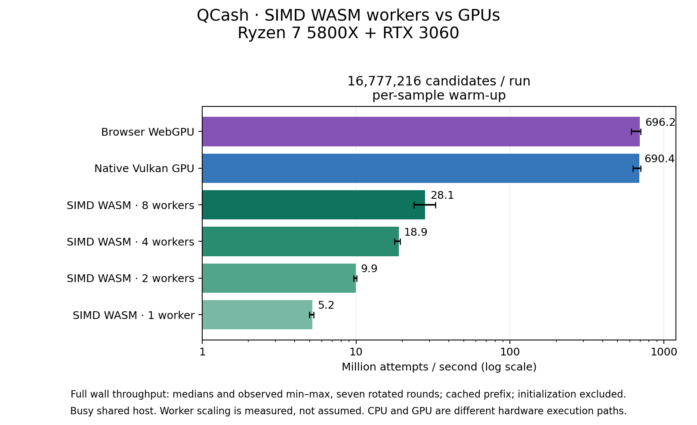
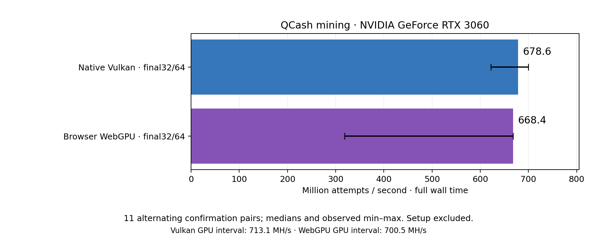
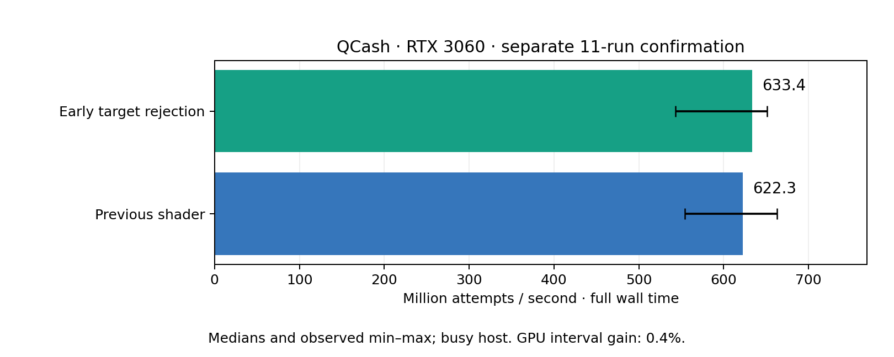
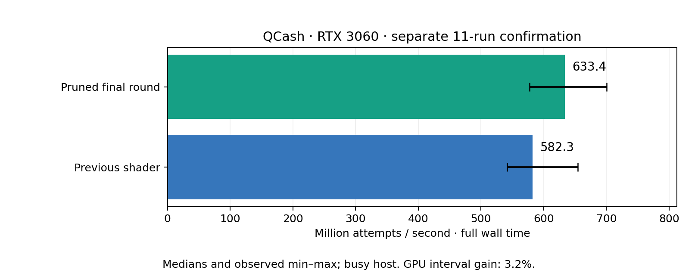
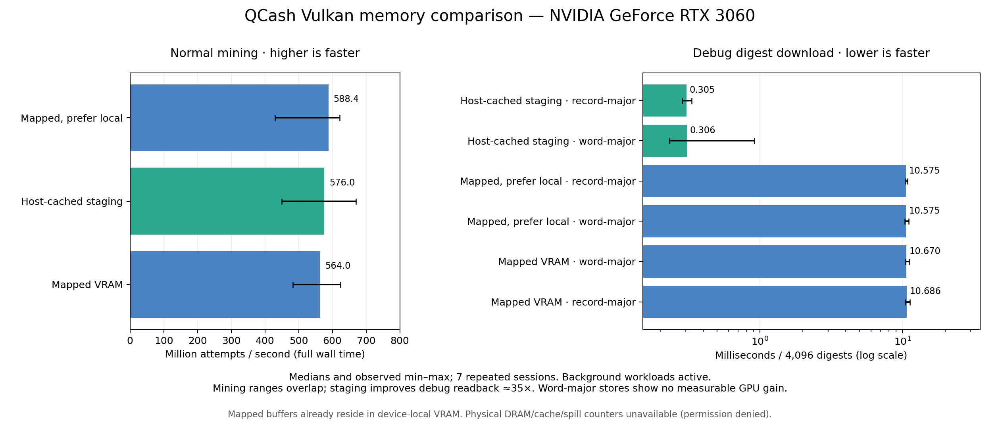
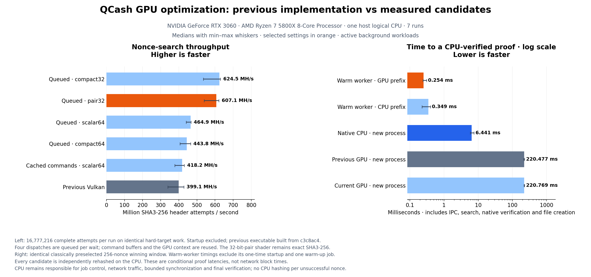
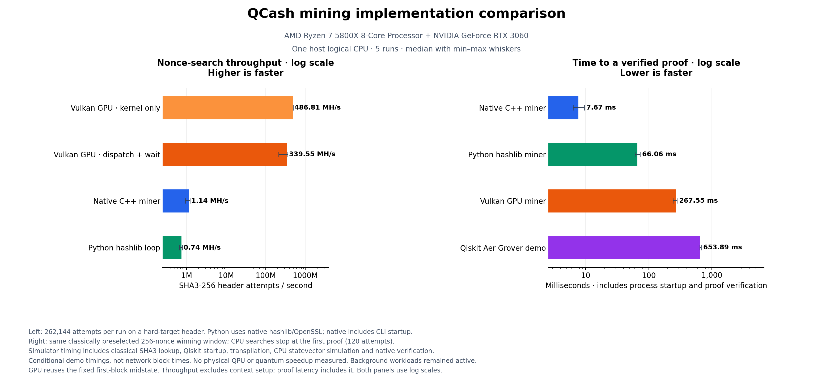

# QCash mining speed

## SIMD multithreaded WASM versus WebGPU



This is a real **C++ SIMD128 WASM miner**, processing two independent nonce hashes
per `i64x2` vector and distributing disjoint ranges across persistent Web Workers.
Every backend uses the same public header, cached first-block prefix, full SHA3-256
semantics and pruned final-round outputs. On the **Ryzen 7 5800X + RTX 3060**, the
final sustained comparison used **16,777,216 candidates per sample**, seven
rotated/reversed rounds, with browser warm-up lasting at least one second before
each recorded sample:

| Implementation | Median full-wall throughput |
| --- | ---: |
| Browser WebGPU | **696.2 million attempts/s** |
| Native Vulkan, default queue grouping | **690.4 million attempts/s** |
| SIMD WASM · 8 workers | **28.1 million attempts/s** |
| SIMD WASM · 4 workers | **18.9 million attempts/s** |
| SIMD WASM · 2 workers | **9.9 million attempts/s** |
| SIMD WASM · 1 worker | **5.2 million attempts/s** |

WebGPU measured **24.8×** the eight-worker WASM throughput. Eight workers improved
over one by **5.38×**, not an assumed eightfold multiplier. The host had other
workloads; the retained ranges and load averages matter. The two GPU medians are
effectively tied in this run, not evidence of universally faster browser shaders.
WebGPU uses one submission/readback for sixteen 1M dispatches; the measured native
default uses sixteen dispatch groups/fence waits. This includes the implementations'
different host synchronization schedules. Startup, compilation and template
preparation are excluded. All seven timed samples are retained.

**Small winning requests favor the CPU path here.** For the same preselected
256-nonce winning window, warmed WASM requests took **0.3–0.5 ms median**, versus
**2.6 ms** for WebGPU. Both include the separate BigInt JavaScript verifier. These
are conditional proof latencies, not expected network block times or cold-start
costs. The CPU pool is useful for small bursts and devices without WebGPU; the GPU
is the stronger sustained throughput path on this hardware. These CPU-vs-GPU
measurements do **not** establish the WASM/native-CPU overhead ratio; that would
require an equivalently optimized native CPU implementation.

### Clock ramp-up and fair warm-up

The initial 1M-candidate comparison measured **4.0 / 6.4 / 10.6 / 11.5 MH/s** for
1/2/4/8 WASM workers, **349.5 MH/s WebGPU**, and **632.1 MH/s native Vulkan**.
An initial-warm-up-only 16M run then alternated between roughly **25 ms and 200 ms**
for the same WebGPU pass after long CPU-only phases. A dedicated
[read-only clock probe](webgpu-idle-clock-probe.json) reproduced the difference on
a visible, focused page: the GPU was in **P8 at 210–300 MHz** before the first pass;
the first pass took **161–232 ms**, and the next took **25.3 ms** with snapshots
showing **P2 at 1,837 MHz**. This supports clock ramp-up as the main cause of that
cold/hot difference, rather than a changed SHA3 workload. Snapshot power readings
are not energy measurements; no driver settings were changed.

One full warm-up batch did not always settle clocks. The final sustained browser
protocol therefore runs complete, untimed ranges for **at least one second** before
each measurement. It stores every warm-up result. Native receipts retain their
internal warm-up plus two full-range samples, explicitly marking the second as
measured. No slow timed samples were filtered from the final dataset. Cold behavior
is still relevant for occasional jobs and remains separately preserved:

- [Initial 1M comparison](wasm-simd-workers-rtx3060.json)
- [Initial-warm-up-only 16M comparison](wasm-simd-workers-sustained-rtx3060.json)
- [Single-warm-up-batch 16M comparison](wasm-simd-workers-warm-rtx3060.json)
- [Final one-second-warmed sustained comparison](wasm-simd-workers-steady-rtx3060.json)
- [Initial/sustained side-by-side chart](wasm-simd-workers-comparison.png); both batch
  size and warm-up protocol differ between panels, so it is not a batch-size-only experiment.

### Implementation and validation

The [WASM module](../miners/wasm/README.md) is a reproducible **6,626-byte** binary
with no host imports. Disassembly contains actual `v128.xor`, `i64x2.shl`,
`i64x2.shr_u` and `v128.andnot` instructions. Each worker owns private, nonshared
1 MiB memory; code is compiled once and cloned to the workers. This is parallel
WASM through Web Workers, **not an Emscripten pthreads benchmark**. No shared memory
or COOP/COEP headers are needed; validation ran with `crossOriginIsolated: false`.

[Validation receipt](wasm-simd-validation.json): **21,284 independent OpenSSL digest
comparisons** cover all four worker counts, both SIMD lanes, odd tails, empty
partitions, nonce carry/overflow, normal/capture winner agreement, cancellation,
disposal and concurrent-use rejection. Host-reference and SIMD-kernel CTests passed.
Rebuilding with the recorded compiler/flags produced byte-identical WASM.

The browser tool now offers WebGPU and 1/2/4/8-worker SIMD WASM in its backend
selector. Nothing mines before Scan. Native full-node acceptance tests passed for
[one CPU worker](wasm-ui-1-worker.json), [eight CPU workers](wasm-ui-8-worker.json),
and the [existing WebGPU path after the UI change](browser-backend-webgpu-ui.json).
WASM selection made no WebGPU adapter request. Every winning result still receives
independent host SHA3 verification, and native nodes retain full consensus checks.
No physical CPU utilization, energy, hardware cache traffic or JIT register counts
are inferred from worker counts or elapsed timings.

```sh
python3 tools/test_wasm_mining.py --attempts 16777216 --warm-seconds 1 --output benchmarks/my-simd-steady.json
python3 tools/test_wasm_mining.py --attempts 1048576 --cold --output benchmarks/my-simd-initial.json
python3 tools/plot_wasm_mining.py benchmarks/my-simd-steady.json --output benchmarks/my-simd.png
python3 tools/probe_webgpu_idle.py --output benchmarks/my-clock-probe.json
```


## Browser WebGPU mining



The browser now implements the measured native architecture: persistent GPU
buffers/pipelines, GPU-side first-block prefix preparation, paired-u32 Keccak,
final-round pruning, grouped dispatches and a tiny winner-only readback. Eight
browser configurations (full/pruned final round × four workgroup sizes) were
compared in seven randomized rounds with an interleaved native control. The
selected **`final32/64`** configuration then underwent eleven separate alternating
confirmation pairs against native Vulkan `final32/64`:

| Backend | Full-wall median | GPU-interval median | Full-wall observed range |
| --- | ---: | ---: | ---: |
| Native Vulkan | 678.6 MH/s | 713.1 MH/s | 622.3–700.1 MH/s |
| Browser WebGPU | 668.4 MH/s | 700.5 MH/s | 318.4–668.4 MH/s |

The browser reaches **98.5% of native by the ratio of full-wall medians**. Its
median paired throughput ratio was 97.5%, and native led all eleven pairs. Browser
wall-time outliers were larger; the near-native median is not a latency guarantee.
All samples, including the slow browser sample, are retained. The GPU intervals
are closer than the broad wall-time tails suggest, but no stall/occupancy diagnosis
is inferred from them.

Each throughput round hashes every one of 16,777,216 candidates against the same
hard-target header, with no CPU hashing of unsuccessful candidates. Browser GPU
intervals cover the mining pass; wall time includes submissions and mapped
readback. Native timings retain their existing dispatch/fence scope. Initialization
and prefix preparation are excluded from both steady-state rates. Browser results
use sixteen 1M-candidate dispatches with one submission/readback per round; the
native default uses sixteen groups/waits per round. These are the implementations'
measured configurations, not identical host synchronization schedules.

Chrome **150.0.7871.128** exposed an NVIDIA Ampere hardware adapter; this host has
one NVIDIA GPU, **RTX 3060, driver 580.142**. The browser hides the specific model
string. The hardware runner rejects a recognized software/fallback adapter for
speed measurements. Headless hardware Chrome exposed no adapter here; recorded
hardware tests used the host display. Software-mode runs are correctness-only.

Normal readback copies/maps only the four-byte winner index, plus 16 timestamp
bytes when supported. Each dispatch uploads 16 parameter bytes; a prepared public
template uploads 272 bytes once. Prefix state remains on the GPU. WebGPU requires
separate MAP_READ staging; this is not a claim of physical zero-copy VRAM access.
The [WebGPU specification](https://www.w3.org/TR/webgpu/) defines the mapping and
timestamp-query constraints. Register allocation, occupancy, cache traffic and
runtime spills were not measured for WGSL; native statistics cannot be transferred.

Every winning result is independently hashed by the included BigInt CPU SHA3
reference and checked against the target. Warm preselected 256-nonce winning
requests measured **2.7 ms median**, including that verification and excluding
initialization. This conditional latency is not a network block-time estimate.
A faster host verifier remains possible; bulk throughput is GPU-resident already.

[Raw performance/correctness receipts](webgpu-final-rtx3060.json),
[shader/source validation manifest](webgpu-validation.json), and
[browser-to-node acceptance receipt](webgpu-ui-rtx3060.json) preserve the evidence.
Validation covers **8,780 OpenSSL digest comparisons**, both shader variants, four
workgroup sizes, forced multi-dispatch capture, partial groups, nonce carry and
overflow, normal/capture winner equivalence, timestamp-free four-byte readback,
concurrent-operation rejection, pre/in-flight cancellation and disposal. Three
Node host-reference tests also pass. The explicit-start browser UI initialized no
GPU before Scan, downloaded a verified block byte-for-byte compatible with native
completion, and advanced an isolated pinned local node to height 1.

The reusable [module and browser tool](../miners/webgpu/README.md) start no mining
on page load and require no wallet secrets. This is a standalone public-work-file
tool; hosted OrgPortal routes/deployment were not changed. Production networking,
chain/reward/tip checks and full consensus validation remain with the native node.

```sh
python3 tools/test_webgpu_mining.py --output benchmarks/my-webgpu.json
python3 tools/test_webgpu_ui.py --output benchmarks/my-webgpu-ui.json
python3 tools/plot_webgpu_mining.py benchmarks/my-webgpu.json --output benchmarks/my-webgpu.png
```


## Focused instruction-dependency, scheduling and register-pressure experiments

**The default remains `final32/64`.** Five additional transformations were
implemented and validated, but none established a reliable improvement sufficient
to replace it. All five still use **92 driver-reported registers per thread**.
Lower source-level temporary counts did not lower the allocated register count.

| Experiment | Option | GPU change in matching sweep rounds, median | Registers |
| --- | --- | ---: | ---: |
| Balanced five-input XOR parity trees | `tree32` | −4.79% | 92 |
| Consume theta corrections column by column | `column32` | +0.17% | 92 |
| In-place permutation plus final-round pruning | `lean32` | −0.07% | 92 |
| Consume final-round chi inputs as they become available | `tail32` | −0.10% | 92 |
| Stop target comparison at the first unequal word | `early32` | +1.05% | 92 |

These are exploratory **seven-round GPU-interval ratios**, each paired with
`final32/64` from the same sweep round, not absolute rates pooled across runs.
The first three cases and last two cases used separate sweeps. Large occasional
outliers remain in the raw data, including a −43% rolling-tail ratio and a +31%
early-rejection ratio under background load. They are not discarded or treated as
shader improvements. Both prefix modes, digest capture and normal target search
continue to produce the same SHA3-256/consensus results.

Three separate eleven-pair confirmations against the exact validated `4582804`
executable produced:

| Candidate and selection | GPU median change | Full-wall median change | Paired wins: GPU / wall |
| --- | ---: | ---: | ---: |
| `lean32/64`, first sweep wall winner | −0.44% | −0.58% | 6/11 · 6/11 |
| `tail32/128`, second sweep wall winner | +1.31% | +6.05% | 6/11 · 8/11 |
| `early32/64`, preselected from GPU sweep | +0.40% | +1.78% | 8/11 · 5/11 |



The small, mixed confirmation gains do not establish a dependable end-to-end win.
In particular, early rejection did not win a majority of wall-time pairs. These
options remain explicitly experimental; no default selection or running production
miner was changed. Register count, binary size and zero reported shared memory are
static compiler observations. Equal footprints do not prove identical machine
instructions, nor establish occupancy, spills or instruction stall reasons.

Raw data: [first sweep/confirmation](gpu-dependencies-rtx3060.json),
[rolling-tail and early-rejection sweep](gpu-dependencies-tail-rtx3060.json),
[preselected early-rejection confirmation](gpu-dependencies-early-confirmation-rtx3060.json).
Full charts: [first sweep](gpu-dependencies-rtx3060.png),
[second sweep](gpu-dependencies-tail-rtx3060.png).
[Validation](gpu-dependencies-validation.json): all 13 suites passed with Vulkan
synchronization validation, 237,468 independent OpenSSL digest comparisons, and
all 13 SPIR-V modules validated. Normal target-search results are also checked
against independent expected winners, including cached capture/noncapture switches.

A [fresh counter attempt](gpu-dependencies-counter-status.json) could not start
because noninteractive sudo authorization was unavailable. Driver policy was not
changed. The earlier authorized hardware capture concerns the earlier recorded
binary; its occupancy cannot be assigned to these variants. Fresh occupancy and
shader-level stall/dependency measurements are needed to establish why 92 registers
persist and whether that limits throughput. Nsight Systems supplies GPU-wide
activity/residency metrics, not a per-instruction stall diagnosis. To refresh the
available hardware readings, run in your terminal with a new output directory:

```sh
sudo -v
python3 tools/profile_vulkan_memory.py --tool systems --sudo --output .deps/dependencies-authorized-v2
```

Reproduce with a separately built `4582804` executable as `BASELINE_QCASH_VULKAN`:

```sh
python3 tools/benchmark_vulkan_scheduling.py --baseline BASELINE_QCASH_VULKAN --baseline-shader final32 --shaders final32,tree32,lean32,column32 --output benchmarks/my-dependencies.json
python3 tools/benchmark_vulkan_scheduling.py --baseline BASELINE_QCASH_VULKAN --baseline-shader final32 --shaders final32,tail32,early32 --output benchmarks/my-tail.json
python3 tools/benchmark_vulkan_scheduling.py --baseline BASELINE_QCASH_VULKAN --baseline-shader final32 --confirm-case early32/64 --output benchmarks/my-early-confirmation.json
python3 tools/plot_vulkan_scheduling.py benchmarks/my-early-confirmation.json --output benchmarks/my-early-confirmation.png
```


## Shader scheduling and final-round pruning



The new default is **`final32`, workgroup 64**. It retains the paired 32-bit Keccak
operations, performs 23 complete rounds, and computes only the four consumed output
lanes in round 24. All dependencies of those lanes are retained. This is exactly
the same SHA3-256 digest and consensus rule, not a reduction in hash rounds/security.
Normal mining also uses a capture-free pipeline specialization; full debug capture
uses a separate specialization of the same shader.

Seven randomized sweep rounds compared five shaders at four workgroup sizes. The
same `final32/64` case led both median full-wall and GPU-interval throughput. A
separate eleven-pair confirmation against the pre-change `38c6739` executable gave:

| Measured throughput | Previous paired-word shader | Pruned final round | Change |
| --- | ---: | ---: | ---: |
| Full wall time | 582.28 MH/s | 633.44 MH/s | +8.79% |
| GPU interval | 713.75 MH/s | 736.65 MH/s | +3.21% |

The candidate won all eleven paired GPU intervals and nine of eleven full-wall
pairs. Active background workloads affect wall timing; the larger wall gain is not
all attributable to shader execution. These rounds contain 67,108,864 attempts,
exclude initialization, and do not measure network block times. Benchmark setup
medians were 313 ms previous and 355 ms current; both specializations are created
up front and the resident worker amortizes that setup.

[Complete sweep chart](gpu-scheduling-rtx3060.png), [raw receipts](gpu-scheduling-rtx3060.json)
and [validation](gpu-scheduling-validation.json) preserve both time scopes, source
and binary hashes, static compiler diagnostics and all samples. Defaults were
selected after the measurements; every measured case explicitly supplied shader
and workgroup, so that selection does not alter the tested kernels.

The row-fused (`row32`) and two-round-unrolled (`unroll32`) variants remain explicit
experimental options. The initial unspecialized [study](gpu-scheduling-initial-rtx3060.json)
found only a small row-fusion benefit. A subsequent specialized sweep was
[interrupted after four checkpointed rounds](gpu-scheduling-specialized-partial-rtx3060.json);
it is not a completed comparison. The final matrix above was restarted and completed.

Register pressure did **not** improve: the driver reports 92 registers for the
selected pruned shader versus 72 for the old default, with zero reported shared
memory versus 768 bytes. Current capture-free `pair32/64` reports 74 registers.
Removing unused operations beat the attempted reductions in temporary lifetimes on
this GPU. These are static compiler statistics, not measured spill traffic or
achieved occupancy. Cache hit rates, runtime spills and stall reasons remain
unmeasured; the earlier authorized counter capture applies to the previous shader.
Performance on other devices needs separate measurements; the previous shader
remains available with `--shader pair32 --workgroup 64`.

To reproduce, build commit `38c6739` separately as `BASELINE_QCASH_VULKAN`, then run:

```sh
python3 tools/benchmark_vulkan_scheduling.py --baseline BASELINE_QCASH_VULKAN --output benchmarks/my-scheduling.json
python3 tools/plot_vulkan_scheduling.py benchmarks/my-scheduling.json --output benchmarks/my-scheduling.png
```

The sweep checkpoints after each complete round. `--resume` requires identical
binaries and shader sources. Use a new output file for changed implementations.


## Authorized hardware-counter follow-up

The authorized Nsight Systems run succeeded. [Sanitized readings and raw artifact
hashes](gpu-memory-authorized-rtx3060.json) supersede the earlier permission-denied
receipt for counter availability; the earlier timing study remains unchanged.
There are **79,804 samples** inside **4,962 target submit-to-fence windows**:

| Metric | Median | Interquartile range |
| --- | ---: | ---: |
| SM Active | 100% | 95–100% |
| SM Issue | 53% | 50–53% |
| Compute Warps In Flight | 58% | 47–58% |
| Unallocated Warps in Active SMs | 42% | 42–42% |
| DRAM Read Throughput | 0 | 0–0 |
| DRAM Write Throughput | 0 | 0–0 |

The DRAM values are native rounded percentage-throughput readings, **not bytes/s**;
zero does not establish zero traffic. Occasional recorded maxima were 31 and 45
respectively. NVIDIA documents the normalized metrics in the
[Nsight Systems guide](https://docs.nvidia.com/nsight-systems/2022.4/pdf/UserGuide.pdf).

**Inference:** typical external-memory bandwidth is unlikely to be the principal
normal-mining bottleneck in this capture. SMs are active almost continuously while
issue utilization and warp residency leave headroom. Prioritize instruction
scheduling, dependency chains and register-pressure experiments over more VRAM
layout changes. These counters do not prove which of those limits execution, nor
that the remaining percentage is recoverable performance.

Samples are GPU-wide, restricted by target API windows rather than isolated kernel
timestamps; other clients contributed (graphics warps occasionally appeared).
Cache hit rates, runtime spill traffic and instruction stall reasons remain
**unmeasured**. The profile used the final default-selection binary recorded in the
receipt; it is a diagnostic run, not another uninstrumented speed comparison.
Raw profiler files remain private under `.deps/vram-authorized`.

## VRAM placement and digest-readback study



Mapped buffers already occupy device-local VRAM on this RTX 3060: memory type 5,
heap 0, DEVICE_LOCAL | HOST_VISIBLE | HOST_COHERENT, without HOST_CACHED.
Prioritizing device locality selects the same type. Explicit staging uses unmapped
GPU-local type 1 plus coherent, host-cached system-memory type 4 for transfers.
`info` now reports these actual selections rather than assuming placement.

Seven rotated-order runs measured normal full-wall throughput of **564.0 MH/s
mapped**, **588.4 MH/s mapped-local**, and **576.0 MH/s staged**. Their observed
ranges overlap substantially under active background load. GPU intervals were
approximately 655, 655 and 650 MH/s respectively. There is no demonstrated mining
benefit from staging; mapped remains the normal default. Warm verified proof
requests were approximately 0.368–0.370 ms, excluding worker setup and using a
preselected winning window, not expected network block times.

For debug capture of 4,096 complete digests, cached staging reduced full wall time
from **10.686 ms to 0.305 ms (35×)**. Capture therefore automatically selects staged
memory unless `--memory` is explicitly supplied. This gain applies to bulk debug
readback; normal mining returns only a winning index. CPU decoding first snapshots
the buffer sequentially. The optional word-major (`soa`) GPU store layout produced
no measurable GPU gain against record-major (`aos`), which remains the default.
GPU capture intervals were approximately 17–18 microseconds; those timestamps end
before result copying and host decoding.

[Raw receipts](gpu-memory-rtx3060.json) retain all seven measurements, actual memory
topologies, binary/source hashes, warm proof receipts and methodology. Capture
samples summarize 20 iterations per session. The matrix used source `9f00ff4`;
subsequent defaults select the measured mapped-mining/staged-debug paths. Every
matrix case explicitly supplies its memory policy and layout.

Explicit copy-byte counts describe Vulkan API payloads, **not physical DRAM,
cache or PCIe traffic**. Mapped CPU accesses still cause hardware traffic.
[Profiling availability](gpu-memory-counters-rtx3060.json) records a successful
Nsight Systems Vulkan timeline capture/export but hardware-counter permission
error 17. DRAM traffic, cache-hit rates and runtime spills remain null/unmeasured.
Nsight Graphics attachment failed twice. Driver internal representations were
empty; static register/shared-memory statistics do not establish runtime occupancy
or spills, and an implausible local-memory field is flagged rather than used.

[Validation](gpu-memory-validation.json): all 13 suites passed; 74,016 independent
OpenSSL digest comparisons cover three memory policies, four shaders, both prefix
modes, both layouts and command reuse. The staged worker proof was accepted by a
local node. No new GPU device-loss event was observed during this study; the older
failure receipt remains retained below.

```sh
python3 tools/benchmark_vulkan_memory.py --output benchmarks/my-memory.json
python3 tools/plot_vulkan_memory.py benchmarks/my-memory.json --output benchmarks/my-memory.png
```


## Resident GPU worker and shader optimization



The previous default Vulkan path used a persistent local worker, cached command buffers,
four bounded dispatches per fence wait, GPU-side prefix preparation and the exact
`pair32` SHA3 shader. No unsuccessful nonce is hashed on the CPU. One independent
CPU rehash of a winning proof remains, along with network/job control and occasional
queue submissions. The node still performs its complete consensus validation.

In the final seven-run comparison on the RTX 3060, the selected default measured
**607.06 million attempts/s** including dispatch/fence overhead, versus
**399.05 million/s** for the previous executable: **52% higher throughput**.
GPU execution intervals measured **655.71 million/s**, up **34%** from the
previous **487.68 million/s**. Those intervals include barriers between queued
kernels, not just sums of individual kernel times.

Warm, GPU-prefix worker requests took **0.254 ms median** for the same known-winning
256-nonce window, including IPC, work-file read, preparation/search, independent
CPU verification and private output creation. The one-time worker setup was
**156.75 ms** and is excluded from warm latency; a new GPU process for every job
still took about **220.77 ms**. These are conditional proof latencies, not network
block times or controller-round latency including peer requests/submission.

For each 16,777,216-candidate throughput round, grouping reduced host waits from
**64 to 16**. The optimized worker process used a median **1.26% of one host CPU
core** during these steady-state samples. This excludes the Python parent,
network/node processes, initialization and driver work outside the process. It
is not a claim that the entire miner uses zero CPU. All steady-state samples
reported zero command-buffer recordings after the shape was warmed.

The compact 32-bit variant measured **624.52 million/s** in this confirmation
run, slightly above the selected pair variant. Pair32 led the initial selection
run and uses 74 driver-reported registers versus compact32's 76; both variants'
wall-time ranges overlap, and these samples do not establish a universal winner.
Both remain selectable. The 64-bit compact variant used 80 registers: fewer
source temporaries did not translate into fewer physical registers. Paired-word
code was smaller than scalar64 (7,936 versus 9,984 bytes), while both used 74
registers. No runtime occupancy or execution-stall counters are claimed. An
implausible driver-reported per-thread local-memory field is retained and flagged,
not interpreted as an actual allocation or used to calculate occupancy.

Raw/provenance records:

- [Initial candidate selection](gpu-optimization-selection-rtx3060.json), collected
  before the feature commit (its dirty source flag refers to the in-development
  implementation, not an unchanged baseline executable).
- [First independent confirmation](gpu-optimization-confirmation-rtx3060.json).
- [Final confirmation](gpu-optimized-rtx3060.json), with a separately rebuilt
  `c3c8ac4` baseline, balanced case order, seven repetitions and binary/source hashes.
- [Full CPU/GPU/simulator comparison with persistent-worker latency](mining-speed-resident-rtx3060.png)
  and its [raw measurements](mining-speed-resident-rtx3060.json).
- [Validation receipt](gpu-resident-validation-rtx3060.json): 12 passing CTest
  suites, final three-case worker suite, 24,672 GPU/OpenSSL comparisons across all
  variants/preparation modes, SPIR-V validation and Vulkan validation-layer checks.

An intervening benchmark stopped with `VK_ERROR_DEVICE_LOST`; the kernel recorded
NVIDIA Xid 32 for its process. The cause remains unresolved. NVIDIA describes this
as a push-buffer/DMA communication fault; that classification does not establish
this machine's root cause. See the [NVIDIA Xid catalog](https://docs.nvidia.com/deploy/xid-errors/analyzing-xid-catalog.html)
and the [retained failure record](gpu-device-loss-rtx3060.json). No GPU reset or
driver change was made. Subsequent digest/validation checks, 20 selected-shader
validation rounds, [50 sustained previous/current rounds](gpu-post-fault-stress-rtx3060.json),
and the final comparison passed without another observed Xid. The fault is not
silently discarded or counted as a successful sample. Future failed benchmark
commands save partial results and the failing case in a `.failed.json` receipt.
The implementation remains experimental and this is not a GPU reliability
certification.

Reproduce the before/after report from a current checkout with the optional Vulkan
backend built and its [simulator dependencies](../miners/README.md#local-qpu-simulation)
installed if also running the full CPU/GPU/simulator comparison:

```sh
git worktree add --detach .deps/gpu-baseline-src c3c8ac4
cmake -S .deps/gpu-baseline-src -B build-gpu-baseline -G Ninja \
  -DCMAKE_BUILD_TYPE=Release -DOPENSSL_ROOT_DIR="$PWD/.deps/openssl" \
  -DOPENSSL_USE_STATIC_LIBS=ON -DBUILD_TESTING=OFF -DQCASH_VULKAN=ON
cmake --build build-gpu-baseline --parallel 2 --target qcash-vulkan
python3 tools/benchmark_vulkan_optimizations.py --selected-shader pair32 \
  --repeats 7 --output benchmarks/my-resident-gpu.json
python3 tools/plot_vulkan_optimizations.py benchmarks/my-resident-gpu.json \
  --output benchmarks/my-resident-gpu.png
```

The scripts use one allowed host logical CPU and leave background workloads running;
whiskers show min/max spread. The final source-tracked state was clean; untracked
measurement outputs explain the separate general dirty flag. A baseline worktree
already created on this host can be reused. See the [miner guide](../miners/README.md#vulkan-gpu-mining)
for controller options and the private worker protocol.


## Previous CPU, Vulkan GPU and simulator comparison



That earlier same-workload run used an AMD Ryzen 7 5800X host with one logical
CPU and an NVIDIA GeForce RTX 3060 (driver 580.142). Five runs measured:

- Vulkan kernel: **486.81 million header attempts/s** from GPU timestamps.
- Vulkan dispatch plus fence wait: **339.55 million attempts/s**.
- Native single-thread CPU baseline: **1.14 million attempts/s**.
- Python/hashlib loop: **0.74 million attempts/s**.

The measured GPU dispatch throughput is about **298 times** the single-thread
CPU baseline. Both use SHA3-256, but the GPU also caches the first fixed rate
block; the CPU baseline recomputes both blocks. This is not a comparison against
an optimized multicore or SIMD midstate CPU miner. GPU throughput excludes
context/pipeline startup, uses persistent mapped buffers, and performs no
per-candidate transfers. Individual samples and GPU timestamp receipts are saved
in [the raw comparison](mining-speed-ryzen5800x-rtx3060.json).

For a new process on the same known-winning 256-nonce fixture, median proof
latencies were **7.67 ms CPU**, **66.06 ms Python**, **267.55 ms GPU**, and
**653.89 ms simulator**. Vulkan setup dominates this tiny job. The library
reuses its context across dispatches, while the command-line controller currently
at that revision started a new process for each work round. Keeping that context
across work rounds was a further optimization; these results do not conceal the current startup cost.
Driver caches may already be warm, so these are new-process timings, not a claim
of completely cold driver caches.

Throughput uses 262,144 complete attempts per round, the same hard-target header
for all CPU/GPU paths, and alternating measurement order. CPU CLI timing includes
process startup; Python hashing runs warm in the benchmark process. The GPU
benchmark verifies 256 shader hashes natively before timing and uses workgroups
of 64 with a 262,144-candidate dispatch limit. Kernel timing brackets the compute
command, while dispatch wall time also includes command recording, submission,
synchronization and readback. The comparison window took 0.0104 seconds to select
classically; CPU miners stop at its first winner after 120 attempts, while the GPU
and simulator evaluate the full window. These are conditional proof latencies,
not expected network block times.

Background workloads were not stopped (host load average approximately 14–15
across 16 logical CPUs). Min/max whiskers show sample spread. Telemetry snapshots
are retained, but they do not measure steady-state miner power or energy per hash.
All 12 CTest suites passed, including 3,084 GPU/OpenSSL digest comparisons,
nonce-boundary/batch checks, real loopback block acceptance and the GPU controller.
The shader also passed SPIR-V validation and the Vulkan validation-layer run
reported no errors. [Validation receipt](vulkan-validation-rtx3060.json) and
[workgroup tuning samples](vulkan-workgroup-tuning-rtx3060.json) are retained. No GPU result is estimated from ML-KEM measurements.

Reproduce with the optional Vulkan build enabled:

```sh
python3 tools/benchmark_mining.py --vulkan-binary ./build/qcash-vulkan \
  --output benchmarks/my-gpu.json
python3 tools/plot_mining.py benchmarks/my-gpu.json --output benchmarks/my-gpu.png
```

See [GPU setup and controller commands](../miners/README.md#vulkan-gpu-mining).

## Historical CPU-only comparison

The earlier results below compare the native miner, an independent Python/hashlib
reference, and the optional Qiskit Aer Grover demonstration. They do not compare
different consensus hash algorithms: all use QCash's SHA3-256 block header rule.


### Earlier measured result

AMD Ryzen 7 5800X, one logical CPU, five alternating-order repetitions:

| Implementation | Header attempts/s, median | Verified proof latency, median |
| --- | ---: | ---: |
| Native C++ miner | 684,323 | 45.04 ms |
| Python/hashlib reference | 403,891 | 98.87 ms |
| Qiskit Aer Grover demo | Not a quantum hash-throughput measurement | 1,187.87 ms |

Native throughput was about **1.69 times** the Python reference. The simulator's
conditional proof latency was about **26.4 times** native latency. Background
workloads remained active (host load average approximately 32–36 across 16 logical
CPUs); min/max whiskers and individual samples expose the considerable variation.
These are measurements under load, not peak hardware limits.

Throughput uses 262,144 attempts per repetition against the same 268-byte header
with target 1. Every attempt is performed; neither path finds a proof. Native
includes CLI startup, while the Python loop runs warm in the benchmark process.
Python's hash primitive is native OpenSSL through hashlib, not Python SHA3 code.
Native uses OpenSSL 3.5.9; Python uses OpenSSL 3.0.13, so this is an implementation
stack comparison, not an isolated language benchmark.

Proof latency uses separate processes on the same classically preselected
256-nonce window containing one winner. CPU searches stop after 111 attempts.
The simulator hashes all 256 candidates classically, builds the truth-table
oracle, runs an eight-qubit circuit with 12 Grover iterations and 128 shots, then
passes a measured winning nonce through native proof verification. Timing includes
process startup, simulator imports, transpilation, simulation and native proof
construction/verification. Network submission and template setup are excluded.
Each resulting proof is independently checked with hashlib outside the timer.

Finding the fixture window took 0.755 seconds of classical native search, excluded
from all conditional proof latencies and recorded in the raw results. Consequently
these latencies are **not expected network block times**. The simulator has already
found every winner during classical precomputation; the subsequent quantum circuit
is an educational demonstration and supplies no mining speedup.

In that earlier run, no physical QPU, full reversible SHA3 statevector, Vulkan,
WebGPU or WASM mining backend was timed in that earlier experiment; see the new browser comparison above. ML-KEM encryption benchmarks are unrelated to mining throughput.
The reversible SHA3 reference is for circuit correctness/resource exploration,
not a competitive CPU miner.

## Reproduce locally

Build the native release binary and install the optional simulator dependencies
as described in [the miner guide](../miners/README.md#local-qpu-simulation).
Then, from the repository root:

```sh
python3 tools/benchmark_mining.py --output benchmarks/my-machine.json
python3 tools/plot_mining.py benchmarks/my-machine.json --output benchmarks/my-machine.png
```

The plotting script requires Matplotlib. The benchmark defaults to five rounds,
262,144 hash attempts per throughput round, and an eight-qubit search window.
`--cpu` selects a permitted logical CPU (default: the first allowed CPU). It uses
an isolated temporary loopback node and disposable keys, never the hosted chain.
Its output file must not already exist. Raw samples, simulator receipts, public
fixture bytes, binary digest, versions, affinity and host load are retained in
[the JSON result](mining-speed-ryzen5800x.json).

The native source commit in that result identifies the binary's source; the dirty
flag records that the newly added benchmark scripts had not yet been committed.
No consensus or native mining code was changed for this measurement.
