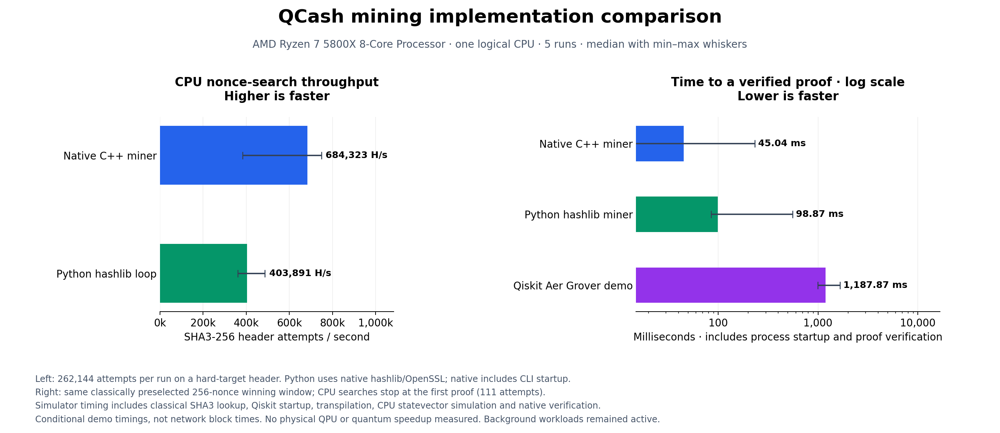

# QCash mining speed

These results compare the current native miner, an independent Python/hashlib
reference, and the optional Qiskit Aer Grover demonstration. They do not compare
different consensus hash algorithms: all use QCash's SHA3-256 block header rule.



## Measured result

AMD Ryzen 7 5800X, one logical CPU, five alternating-order repetitions:

| Implementation | Header attempts/s, median | Verified proof latency, median |
| --- | ---: | ---: |
| Native C++ miner | 684,323 | 45.04 ms |
| Python/hashlib reference | 403,891 | 98.87 ms |
| Qiskit Aer Grover demo | Not a quantum hash-throughput measurement | 1,187.87 ms |

Native throughput was about **1.69 times** the Python reference. The simulator's
conditional proof latency was about **26.4 times** native latency. Background
workloads remained active (host load average approximately 32–36 across 16 logical
CPUs); min/max whiskers and individual samples expose the considerable variation.
These are measurements under load, not peak hardware limits.

Throughput uses 262,144 attempts per repetition against the same 268-byte header
with target 1. Every attempt is performed; neither path finds a proof. Native
includes CLI startup, while the Python loop runs warm in the benchmark process.
Python's hash primitive is native OpenSSL through hashlib, not Python SHA3 code.
Native uses OpenSSL 3.5.9; Python uses OpenSSL 3.0.13, so this is an implementation
stack comparison, not an isolated language benchmark.

Proof latency uses separate processes on the same classically preselected
256-nonce window containing one winner. CPU searches stop after 111 attempts.
The simulator hashes all 256 candidates classically, builds the truth-table
oracle, runs an eight-qubit circuit with 12 Grover iterations and 128 shots, then
passes a measured winning nonce through native proof verification. Timing includes
process startup, simulator imports, transpilation, simulation and native proof
construction/verification. Network submission and template setup are excluded.
Each resulting proof is independently checked with hashlib outside the timer.

Finding the fixture window took 0.755 seconds of classical native search, excluded
from all conditional proof latencies and recorded in the raw results. Consequently
these latencies are **not expected network block times**. The simulator has already
found every winner during classical precomputation; the subsequent quantum circuit
is an educational demonstration and supplies no mining speedup.

No physical QPU, full reversible SHA3 statevector, Vulkan, WebGPU or WASM mining
backend was timed. ML-KEM encryption benchmarks are unrelated to mining throughput.
The reversible SHA3 reference is for circuit correctness/resource exploration,
not a competitive CPU miner.

## Reproduce locally

Build the native release binary and install the optional simulator dependencies
as described in [the miner guide](../miners/README.md#local-qpu-simulation).
Then, from the repository root:

```sh
python3 tools/benchmark_mining.py --output benchmarks/my-machine.json
python3 tools/plot_mining.py benchmarks/my-machine.json --output benchmarks/my-machine.png
```

The plotting script requires Matplotlib. The benchmark defaults to five rounds,
262,144 hash attempts per throughput round, and an eight-qubit search window.
`--cpu` selects a permitted logical CPU (default: the first allowed CPU). It uses
an isolated temporary loopback node and disposable keys, never the hosted chain.
Its output file must not already exist. Raw samples, simulator receipts, public
fixture bytes, binary digest, versions, affinity and host load are retained in
[the JSON result](mining-speed-ryzen5800x.json).

The native source commit in that result identifies the binary's source; the dirty
flag records that the newly added benchmark scripts had not yet been committed.
No consensus or native mining code was changed for this measurement.
